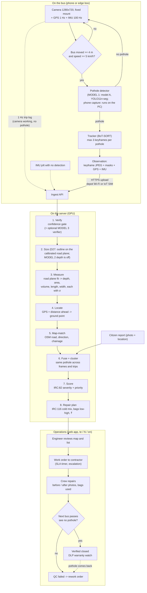

# RoadFix — how the system works

RoadFix finds potholes from cameras on buses (and phones), measures how big they are, decides how urgent each one is,
plans the repair (cold-mix bags and cost) and follows the repair until a later bus pass proves it was fixed.

This page explains the flow from the camera to the closed work order, and which AI model is used at which step.
Design detail: [`PLAN.md`](PLAN.md). Changes to the plan: [`DECISIONS.md`](DECISIONS.md). Current status:
[`HANDOFF.md`](HANDOFF.md).

---

## 1. The whole flow

---

## 2. Step by step

| # | Where | What happens | Why | Code |
|---|---|---|---|---|
| 1 | Bus | The camera runs all the time, but a frame is only taken every **4 m of travel** above 5 km/h | Equal road coverage at any speed; nothing is sent while the bus waits at a stop | `edge/protocol.md` |
| 2 | Bus / PC | **MODEL 1** (model A) finds potholes and draws their outlines in each frame. With the phone capture (D28) the phone uploads every keyframe and the PC runs the model (`tools/capture_worker.py`) | Only keyframes are sent; video is never uploaded | `edge/`, `tools/capture_worker.py` |
| 3 | Bus | The tracker follows each pothole and keeps **at most 3 keyframes**: first sight (about 10 m), middle, nearest (about 3 m) | Several views make the size more accurate; 3 limits data | `edge/protocol.md` |
| 4 | Bus | Each keyframe is sent with masks, confidence, GPS (position, speed, heading) and IMU (vertical shake) | GPS places the pothole on the road; IMU feels the wheel hitting it | `edge/schema/` |
| 5 | Bus | A 1 Hz trip log says where the bus drove with a working camera | Proves "a bus passed here and saw nothing" (needed to close repairs) | `trip_fix.schema.json` |
| 6 | Server | **Verify**: detections below the confidence gate are dropped; MODEL 3 can double-check (off now) | Removes false alarms (shadows, patches, wet road) | `server/workers/stages.py` |
| 7 | Server | **Size** (D27, default): the pothole outline is projected onto the road plane known from the camera height and tilt -> width, length, area in metres with σ. Depth (MODEL 2) is **off**; `DEPTH_BACKEND=da2_metric` turns it back on | Monocular depth on bus frames was unproven; IRC:82 can grade by width | `measure/ground_geom.py` (`measure/depth_backends/` when depth is on) |
| 8 | Server | **Measure**: size-only by default (D27): area (m²), length and width (m) from the outline on the road plane, each with σ and a quality score. With depth on, the road around the pothole is fitted and depth (p95, max mm) and volume (litres) are added | Bad frames are rejected with a reason | `measure/surface.py`, `measure/pothole_geom.py` |
| 9 | Server | **Locate + map-match**: GPS fix moved forward by the measured distance, snapped to the OSM road and direction | Two potholes in opposite lanes stay separate | `geo/` |
| 10 | Server | **Fuse + cluster**: frames of the same pothole are combined (inverse-variance); detections within 6 m on the same road and lane become one pothole | One pothole = one record, however many buses see it | `measure/fuse.py`, `geo/cluster.py` |
| 11 | Server | **Confirm**: a pothole becomes *confirmed* after 2 passes from 2 trips, or 1 pass + citizen report, or 1 pass + IMU jolt with good quality | A single false alarm never creates a work order | `docs/CONTRACTS.md` |
| 12 | Server | **Score**: IRC:82 severity (Large: depth > 50 mm or width > 500 mm; Medium: 25–50 mm or 200–500 mm; else Small) and a priority score: severity 30 %, road exposure (road class, bus passes) 25 %, vulnerable places nearby (schools, hospitals, bus stops) 20 %, age against the SLA 15 %, monsoon season 10 %; bonuses for wheel path, junctions, IMU jolt | Fix the most dangerous potholes first | `measure/irc.py`, `priority/`, `configs/priority.default.yaml` |
| 13 | Server | **Plan**: IRC:116 / SP:100 cold-mix repair: cut size, bags as a **low–high range**, labour hours, cost from the rate card | Objective material quantities instead of guesses | `repair/planner.py` |
| 14 | Web | Engineer issues a **work order**; SLA timers escalate AE → DEE → EE → Zonal Commissioner (arterial roads: 24 h) | Nothing is forgotten | `server/app/services/sla.py` |
| 15 | Web | Contractor crew repairs, uploads before and after photos and bags used | Evidence for payment | `web/` |
| 16 | Bus | Later bus passes over the spot: no pothole → **verified closed**; pothole still there → **QC failed** | Repairs are checked by the same buses, automatically | `server/workers/` |
| 17 | Server | If a repaired pothole comes back inside the **DLP** (warranty) period (patch 6 months, CRMP package 5 years), a rework order and evidence package are made | Contractors repair properly | `server/app/services/dlp.py` |

Units everywhere: depth mm, area m², volume litres, lengths m, money INR; times stored in UTC, shown in IST.

---

## 3. Which model is used where

| # | Model | Used at | What it does | Status today |
|---|---|---|---|---|
| **1** | **Model A** `models/base_model/pothole_seg11n.pt` (YOLO11n-seg, one class: pothole; D48, in use since D50) | Phone-capture processing on the PC, server detection, model test page, test dashboards | Finds potholes and draws each outline in **one pass**: the network gives a box, a confidence and 32 mask numbers per pothole, plus 32 shape patterns per photo; the outline is the mix of the patterns, cut to the box | Mean box AP50 0.529 over 17 test sets (`reports/BENCHMARK.md`), clean-road false alarms 0.2 %; gap: phone photos found 11 / 26. `.env SEG_WEIGHTS` |
| 1-edge | Model A exported (`pothole_seg11n.onnx`; int8 TFLite needs TensorFlow, not made yet) | On the bus / phone | Same job on the device | Android app is a skeleton |
| **2** | **Depth Anything V2 Metric** | Server, step 7 | Distance per pixel from one photo | **Off** (D27, `DEPTH_BACKEND=off`); its cached files were deleted (D50); code kept |
| **3** | Verifier (second detector) | Server, step 6 | Double-checks detections | **Off** (`VERIFIER=off`) |
| 4 | **SAM2.1 Hiera Small** (`facebook/sam2.1-hiera-small`) | Dataset building; box-only detectors | Turns a box into an outline (the photo + the box go in, the object inside comes out) | Kept for outlining box-only labels (D45); not needed for detection with model A |
| 5 | BoT-SORT tracker (not a neural model) | On the bus | Gives each pothole one id across frames | Part of Ultralytics |

Box detectors (like the supplied civic YOLO11n in `models/supplied_original/`) give boxes only; RoadFix then gets the
outline in a second step from SAM2, falling back to GrabCut and then an ellipse (`measure/detect.py`). Model A needs
no second step. The size measurement needs the outline, because a box includes good road around the pothole.

### Model A's training data (`datasets/merged_pothole_seg`, D48)
11,877 train / 1,216 val images, 16,821 potholes: the supplied Nagar Netra set (outlined with SAM2) plus RDD-India,
RDD other countries, BharatPotHole, Kaggle web photos and eYantra; cracks, manholes and clean roads are background. The
split keeps near-duplicates, drives and photo variants together, and leaves out near-copies of test photos. On-the-fly
augmentation (`ml/augment/hard.py`): zoom 0.3–1.7, perspective, roll (camera height and pitch), lens distortion and
field of view, night driving (headlights, street lamps, noise), weather. The night / zoom check sets
(`make check-sets`) measure those invariances. The next gain comes from marked photos of the target streets.

---

## 4. What makes a depth measurement trustworthy

Depth from one photo only works when:

1. The camera is **fixed** (bus windscreen or dashboard), facing forward, slightly down, in **landscape**.
2. Its **height above the road** and **tilt** are measured and saved in a calibration certificate (`configs/cameras/`,
   [`CALIBRATION_SOP.md`](CALIBRATION_SOP.md)).
3. The pothole is on **paved road**, about **3–7 m ahead**, with flat road around it.

If any of this fails, the measurement is **rejected with a reason** (for example `surface:plane_inlier_ratio<0.5` =
the ground around it is not flat road; `range_outside_gate` = too close or too far) instead of showing a wrong
number. Every calibration in this repo is `certified=false`: numbers are for prioritising, not billing. Bags are
always a range, never an exact count.

---

## 5. Tools for the team

| Tool | Command | Address | For |
|---|---|---|---|
| Pipeline dashboard | `make e2e-dashboard` | http://&lt;pc-ip&gt;:8795 | One drive (the dummy demo drive or a real one) through every stage: frames, detections, sizes, severity, plans, work orders |
| Dummy end-to-end run | `make e2e-demo` | terminal, then the pipeline dashboard | Dummy phone drive (public test photos along Banjara Hills Road No. 10) -> model A -> API on a demo DB copy -> plans, work orders, repair run, KPIs. Not field data |
| Phone as bus camera + Drives dashboard | `make capture` (office LAN) or `make capture-public` (any network, ngrok) | https://&lt;pc-ip&gt;:8443 or the ngrok URL; `/dashboard`, `/annotate` | A phone records keyframes every 4 m, GPS and jolts; the PC runs model A and sends the drive to the API (D28) |
| Annotation + failure review | `make annotate` | http://&lt;pc-ip&gt;:8775 | Draw potholes on drives; "Failures of …" sets show test photos where the model fails, with the labels editable (D41, D49); `make annotate-export` writes them |
| Test results | `make results` | http://&lt;pc-ip&gt;:8785 | Every test photo with the model's boxes / outlines; strict or lenient matching; night and zoom check sets (D46) |
| Benchmark | `make benchmark` | `reports/BENCHMARK.md` | The model in use on all 17 test sets |
| Train | `make merged-dataset`, `make train-merged ONLY=A` | terminal | Retrain model A; adopted only if not worse on any test set |
| Training dashboard | `make dashboard` | http://&lt;pc-ip&gt;:8765 | Watch training live |
| Project control | `make control` | http://&lt;pc-ip&gt;:8790 | What is left to finish |
| Model test page | `make playground` | http://&lt;pc-ip&gt;:8780 | Upload photos or videos; detection, size, severity, repair estimate |
| Dataset review | `make review` | http://&lt;pc-ip&gt;:8770 | Mark training images keep / reject / fix |
| Simulated fleet demo | `make demo` | API :8000, web :5173 | Simulated buses over 2 days: survey, repair, bus verification, DLP |

---

## 6. What is real and what is demo

| Part | State |
|---|---|
| Detection model (A), training pipeline, dashboards | Real, running on the RTX 5080 |
| Phone capture -> processing -> API | Real code, run on real phone walks; `make e2e-demo` runs the same code on dummy photos |
| Measurement core (size, σ, fusion, IRC, repair plan) | Real code; real-camera accuracy check (`make truth`) still to do |
| Server pipeline, operations, web app | Real code, run end-to-end with simulated buses and the dummy drive |
| Bus app | Simulator works (`edge/sim`); Android and Jetson apps are skeletons |
| Database | SQLite for the demo; PostGIS for production is designed, not run |

Model weights and data are **not in git** (D43): copy `models/base_model/pothole_seg11n.pt` from the project machine,
or rebuild the data and retrain (`make merged-dataset`, `make train-merged ONLY=A`).
