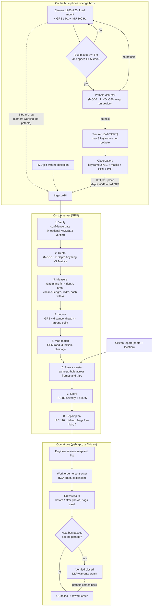

# RoadFix — how the system works

RoadFix finds potholes from cameras on buses, measures how deep and how big they are, decides how urgent each one is,
plans the repair (cold-mix bags and cost) and follows the repair until a later bus pass proves it was fixed.

This page explains the flow from the camera to the closed work order, and which AI model is used at which step.
Design detail: [`PLAN.md`](PLAN.md). Changes to the plan: [`DECISIONS.md`](DECISIONS.md). Current status:
[`HANDOFF.md`](HANDOFF.md).

---

## 1. The whole flow

---

## 2. Step by step

| # | Where | What happens | Why | Code |
|---|---|---|---|---|
| 1 | Bus | The camera runs all the time, but a frame is only taken every **4 m of travel** above 5 km/h | Equal road coverage at any speed; nothing is sent while the bus waits at a stop | `edge/protocol.md` |
| 2 | Bus | **MODEL 1** looks for potholes in each frame | Only frames with potholes are uploaded; video is never uploaded | `edge/` |
| 3 | Bus | The tracker follows each pothole and keeps **at most 3 keyframes**: first sight (about 10 m), middle, nearest (about 3 m) | Several views make the size more accurate; 3 limits data | `edge/protocol.md` |
| 4 | Bus | Each keyframe is sent with masks, confidence, GPS (position, speed, heading) and IMU (vertical shake) | GPS places the pothole on the road; IMU feels the wheel hitting it | `edge/schema/` |
| 5 | Bus | A 1 Hz trip log says where the bus drove with a working camera | Proves "a bus passed here and saw nothing" (needed to close repairs) | `trip_fix.schema.json` |
| 6 | Server | **Verify**: detections below the confidence gate are dropped; MODEL 3 can double-check (off now) | Removes false alarms (shadows, patches, wet road) | `server/workers/stages.py` |
| 7 | Server | **Depth**: MODEL 2 gives the distance of every pixel in metres | A phone cannot run this model; the server can, and can re-measure later with a better one | `measure/depth_backends/` |
| 8 | Server | **Measure**: fit the flat road around the pothole, lock the scale to the camera height, measure how far the pothole surface lies below the road | Gives depth (p95 and max, mm), area (m²), volume (litres), length and width (m), each with σ and a quality score; bad frames are rejected with a reason | `measure/surface.py`, `measure/pothole_geom.py` |
| 9 | Server | **Locate + map-match**: GPS fix moved forward by the measured distance, snapped to the OSM road and direction | Two potholes in opposite lanes stay separate | `geo/` |
| 10 | Server | **Fuse + cluster**: frames of the same pothole are combined (inverse-variance); detections within 6 m on the same road and lane become one pothole | One pothole = one record, however many buses see it | `measure/fuse.py`, `geo/cluster.py` |
| 11 | Server | **Confirm**: a pothole becomes *confirmed* after 2 passes from 2 trips, or 1 pass + citizen report, or 1 pass + IMU jolt with good quality | A single false alarm never creates a work order | `docs/CONTRACTS.md` |
| 12 | Server | **Score**: IRC:82 severity (Large: depth > 50 mm or width > 500 mm; Medium: 25–50 mm or 200–500 mm; else Small) and a priority score: severity 30 %, road exposure (road class, bus passes) 25 %, vulnerable places nearby (schools, hospitals, bus stops) 20 %, age against the SLA 15 %, monsoon season 10 %; bonuses for wheel path, junctions, IMU jolt | Fix the most dangerous potholes first | `measure/irc.py`, `priority/`, `configs/priority.default.yaml` |
| 13 | Server | **Plan**: IRC:116 / SP:100 cold-mix repair: cut size, bags as a **low–high range**, labour hours, cost from the rate card | Objective material quantities instead of guesses | `repair/planner.py` |
| 14 | Web | Engineer issues a **work order**; SLA timers escalate AE → DEE → EE → Zonal Commissioner (arterial roads: 24 h) | Nothing is forgotten | `server/app/services/sla.py` |
| 15 | Web | Contractor crew repairs, uploads before and after photos and bags used | Evidence for payment | `web/` |
| 16 | Bus | Later bus passes over the spot: no pothole → **verified closed**; pothole still there → **QC failed** | Repairs are checked by the same buses, automatically | `server/workers/` |
| 17 | Server | If a repaired pothole comes back inside the **DLP** (warranty) period (patch 6 months, CRMP package 5 years), a rework order and evidence package are made | Contractors repair properly | `server/app/services/dlp.py` |

Units everywhere: depth mm, area m², volume litres, lengths m, money INR; times stored in UTC, shown in IST.

---

## 3. Which model is used where

| # | Model | Used at | What it does | Status today |
|---|---|---|---|---|
| **1** | **YOLO26m-seg, fine-tuned on Indian roads** (`runs/seg/y26m_seg_india_v2ft_geo/weights/best_pothole.pt`, Ultralytics 8.4.211) | Server detection, the model test page, and the starting point for the bus model | Finds potholes and draws their outline (mask). Classes: pothole, alligator crack, crack, manhole (only potholes are measured) | Trained 2026-11-17: 80 epochs, 640 px, AdamW, camera height / angle augmentation. **RDD-India pothole AP50 0.2494** (target 0.70, not met yet). Set as `SEG_WEIGHTS` in `.env` |
| 1-edge | **YOLO26n-seg** (the small version), exported to LiteRT (Android) or TensorRT (Jetson) | On the bus | Same job, small enough for a ₹10–12k phone | Planned: train from the same data, then export. Android app is a skeleton |
| **2** | **Depth Anything V2 Metric Outdoor Base** (`depth-anything/Depth-Anything-V2-Metric-Outdoor-Base-hf`) | Server, step 7 | Distance of every pixel in metres from one photo. The road-plane fit and the known camera height correct its scale | In use (`DEPTH_BACKEND=da2_metric`). Options: `da3_metric` (DA3 METRIC-LARGE), `metric3d_onnx` for Jetson, `stereo_sgbm` for stereo vans |
| **3** | **Verifier: RF-DETR-Seg-Small** (second, different detector) | Server, step 6 | Double-checks each detection; weak ones it does not confirm are dropped | **Off** (`VERIFIER=off`): the trained verifier scored 0.004 and was deleted. Turn on only with a model that scores well |
| 4 | **SAM2.1 Hiera Small** (`facebook/sam2.1-hiera-small`) | Dataset building only | Turns pothole boxes from RDD2022 into pothole outlines for training | Used when the dataset is rebuilt (`make dataset`) |
| 5 | **BoT-SORT tracker** (not a neural model) | On the bus | Gives each pothole one id across frames | Part of Ultralytics |

Non-AI methods that matter as much as the models: RANSAC road plane + local quadratic fit, scale lock to the
tape-measured camera height, σ propagation, inverse-variance fusion, IMU jolt check, OSM map-matching.

### Model 1 training data (`data/datasets/india_pothole_seg4_v2`)
8,911 train / 1,722 val / 1,843 test images; 14,564 training potholes, 70 % on Indian roads (RDD2022 India,
BharatPotHole, eYantra, human-drawn masks). The 514 RDD-India test images are locked, so every model is scored on the
same images. Next accuracy gain comes from data, not more epochs: review the dataset (`make review`) and add real
frames from bus-mounted cameras.

---

## 4. What makes a depth measurement trustworthy

Depth from one photo only works when:

1. The camera is **fixed** (bus windscreen or dashboard), facing forward, slightly down, in **landscape**.
2. Its **height above the road** and **tilt** are measured and saved in a calibration certificate (`configs/cameras/`,
   [`CALIBRATION_SOP.md`](CALIBRATION_SOP.md)).
3. The pothole is on **paved road**, about **3–7 m ahead**, with flat road around it.

If any of this fails, the measurement is **rejected with a reason** (for example `surface:plane_inlier_ratio<0.5` =
the ground around it is not flat road; `range_outside_gate` = too close or too far) instead of showing a wrong
number. Every calibration in this repo is `certified=false`: numbers are for prioritising, not billing. Bags are
always a range, never an exact count.

---

## 5. Tools for the team

| Tool | Command | Address | For |
|---|---|---|---|
| Model test page | `make playground` | http://&lt;pc-ip&gt;:8780 | Upload photos or videos; see detection, depth, size, severity, repair estimate, plain-English summary |
| Dataset review | `make review` | http://&lt;pc-ip&gt;:8770 | Several people mark training images keep / reject / fix |
| Training dashboard | `make dashboard` | http://127.0.0.1:8765 | Watch training live (loss, accuracy, GPU, time left) |
| Full demo | `make demo` | API :8000, web :5173 | 3 simulated buses over 2 days: survey, repair, bus verification, DLP |
| Retrain | `make train-gpu PROFILE=rtx5080_gpu95_ft_geo NAME=<run>` | terminal | Train a new detector (foreground; keeps 3 GB GPU for the display) |

---

## 6. What is real and what is demo

| Part | State |
|---|---|
| Detection model, training pipeline, dashboards | Real, running on the RTX 5080 |
| Measurement core (depth, surface, σ, fusion, IRC, repair plan) | Real code, tested on synthetic scenes; real-camera accuracy check (`make truth`) still to do |
| Server pipeline, operations, web app | Real code, run end-to-end with simulated buses |
| Bus app | Simulator works (`edge/sim`); Android and Jetson apps are skeletons |
| Database | SQLite for the demo; PostGIS for production is designed, not run |

Model weights are **not in git** (`runs/` and `weights/*.pt` are ignored). After cloning, retrain with `make retrain`
or copy `best_pothole.pt` into `runs/seg/y26m_seg_india_v2ft_geo/weights/`.
